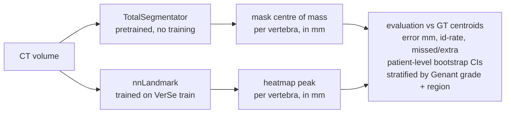
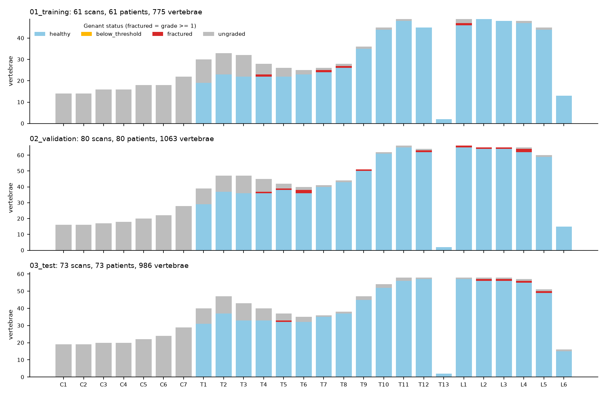
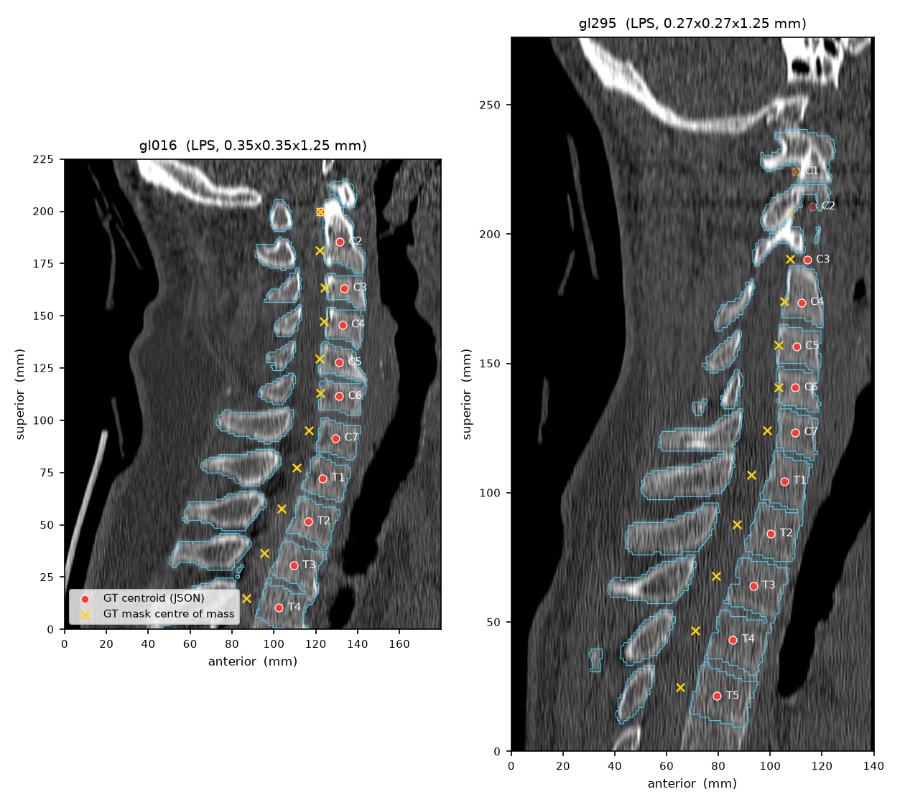

# bone-landmarks-ct

**Do you need a dedicated landmark model?** Training-free vs trained vertebra landmark
localisation on CT, for healthy vs fractured vertebrae (VerSe).

> **Status: work in progress (phase 0 of 5: data and sanity checks).**
> No method has been run yet, so this README contains **no localisation results**.
> Every number below is produced by a script in this repo and stored in [`results/`](results/).

| Phase | Content | Status |
|---|---|---|
| 0 | Data loaders, coordinate conventions, fracture labels, sanity figures | done |
| 1 | Method A: TotalSegmentator → vertebra centroids, metrics, bootstrap CIs | next |
| 2 | Method B setup: nnLandmark data conversion, compute estimate | planned |
| 3 | Method B training + evaluation, paired comparison A vs B | planned |
| 4 | Fracture / region stratification, failure taxonomy, uncertainty | planned |
| 5 | Write-up, clean notebooks, `v1.0` | planned |

## Question

Many clinical landmark tasks start from a structure that a good pretrained segmentation
model already delineates. If the landmark is "the centre of the vertebra", is the centroid
of a **TotalSegmentator** mask as good as a model trained specifically to regress that
landmark (**nnLandmark**)? Does the answer change on **fractured** vertebrae, where shape
priors are violated?



- **Method A (training-free):** TotalSegmentator vertebra masks → centre of mass in world mm.
- **Method B (trained):** nnLandmark (MIC-DKFZ, arXiv 2504.06742) heatmap regression.
- **Metrics:** Euclidean error in mm; VerSe identification rate (closest GT is the same
  label and < 20 mm, as in `anjany/verse` `eval_utilities.get_hits`); missed and extra
  detections counted separately; 95% CIs from a patient-level (cluster) bootstrap.

## Data: VerSe

Subject-based ("restructured") VerSe'20 release from
[anjany/verse](https://github.com/anjany/verse), CC BY-SA 4.0. Data is not in this repo;
see [Reproduce](#reproduce).

Annotated vertebrae in the VerSe'20 zips
([`results/sanity/dataset_summary.csv`](results/sanity/dataset_summary.csv)):

| split | scans | patients | vertebrae | cervical | thoracic | lumbar | fractured (Genant ≥ 1) | healthy | ungraded |
|---|---|---|---|---|---|---|---|---|---|
| training | 61 | 61 | 775 | 118 | 405 | 252 | 4 | 602 | 169 |
| validation | 80 | 80 | 1063 | 137 | 590 | 336 | 11 | 864 | 188 |
| test | 73 | 73 | 986 | 153 | 535 | 298 | 5 | 770 | 211 |



Notes:
- The VerSe'20 zips do **not** contain the VerSe'20 cases that were already in VerSe'19
  (series ids < 500). Those are distributed with the VerSe'19 subject-based release.
- The test zip contains 3 extra challenge-format files (`*_iso-ctd.json`); only the
  subject-based `*_seg-subreg_ctd.json` files are used.

### Fracture labels

Per-vertebra **Genant grades** (thoracolumbar, T1–L6 + T13) for VerSe'19 + '20 are in
`fracture_data/Genant_Fractures_thoracolumbar_reference.csv` on the VerSe'20 OSF
subject-based node ([osf.io/4skx2](https://osf.io/4skx2/)); per the OSF wiki, two raters
with consensus on discrepant cases. They are not inside the download zips.
`scripts/download_verse.sh` fetches the file.

- Cervical vertebrae are never graded, and the 30 Glocker-derived scans (`gl*`) are not in
  the CSV: both appear as *ungraded* above.
- The CSV also contains codes **5** and **8**, which are not Genant grades and are not
  documented with the file. They are treated as *ungraded*, never as fractured or healthy.
- **The VerSe'20-only splits contain very few fractures** (5 graded-fractured vertebrae in
  test). Most graded fractures in the CSV belong to VerSe'19 series. How to handle this is
  an open decision for phase 1 (see [Limitations](#limitations-so-far)).

### Coordinate conventions (and how they are checked)

The subject-based centroid JSON starts with `{"direction": [...]}` (axis codes of the voxel
grid) and stores **voxel** coordinates in that grid. [`src/bonelm/io.py`](src/bonelm/io.py)
maps them into the image array (flip = `n − 1 − i`) and then to world mm with the NIfTI
affine. All distances in this project are computed in world mm.

Checks:
1. Unit tests on synthetic volumes with anisotropic, flipped affines
   ([`tests/test_io.py`](tests/test_io.py)): known centroids, invariance of mm distances to
   array orientation, agreement with nibabel's own reorientation.
2. Every downloaded case: the JSON centroid is compared with the centre of mass of the same
   label in the GT mask ([`scripts/check_centroids.py`](scripts/check_centroids.py)).
   Over 214 scans / 2824 vertebrae: the JSON axis codes always match the image affine, every
   JSON label exists in the mask and vice versa, and no distance exceeds 19.6 mm
   ([summary](results/sanity/centroid_vs_mask_summary.json)). A wrong axis or flip would
   give errors of tens to hundreds of mm.
3. Visual check on randomly drawn training cases (seed 42): JSON centroids (red) and GT-mask
   centres of mass (yellow ×) on a sagittal slice, GT mask contour in blue.

**Finding that matters for Method A: the VerSe centroid is the vertebral *body* centre, not
the centre of the whole vertebra.** The whole-mask centre of mass is pulled backwards by the
posterior elements ([by region](results/sanity/centroid_vs_mask_by_region.csv)):

| group | n | median distance (mm) | median offset R / A / S (mm) |
|---|---|---|---|
| C1 (atlas, no body) | 49 | 0.03 | -0.00 / -0.00 / -0.00 |
| C2–C7 | 359 | 8.60 | 0.12 / -7.98 / 2.74 |
| thoracic | 1530 | 12.58 | 0.05 / -11.94 / 0.39 |
| lumbar | 886 | 12.20 | -0.06 / -11.83 / -1.98 |

C1, which has no body, matches exactly; elsewhere the offset is almost purely
anterior–posterior. A naive "centroid of the TotalSegmentator vertebra mask" therefore
starts with a ~12 mm systematic error even with a perfect segmentation. Phase 1 must
address this explicitly (see [open decisions](#open-decisions-before-phase-1)).



## Open decisions before phase 1

1. **Body vs whole-vertebra centroid for Method A**: use a vertebral-body segmentation
   (if TotalSegmentator provides one under an open licence), or report both the naive
   whole-mask centroid and a variant corrected by a fixed offset estimated on the training
   split only.
2. **Fracture stratification**: add the VerSe'19 subject-based release (which holds most of
   the graded fractures) to the evaluation set, or fall back to another stratification.
3. **Fracture threshold**: Genant ≥ 1 (any) as primary, ≥ 2 (moderate/severe) as sensitivity.

## Reproduce

```bash
python -m venv .venv && source .venv/bin/activate   # Windows: .venv\Scripts\activate
pip install -r requirements.txt && pip install -e .
bash scripts/download_verse.sh dev    # masks + centroids of all splits, 3 training CTs, fracture CSV
python scripts/check_centroids.py     # results/sanity/centroid_vs_mask*.{csv,json}
python scripts/dataset_overview.py    # results/sanity/dataset_summary.csv, figures/dataset_overview.png
python scripts/make_overlays.py       # results/figures/overlay_gt_centroids.png
pytest -q
```

`bash scripts/download_verse.sh` (no argument) downloads the full VerSe'20 zips (~38 GB).
The `dev` mode uses HTTP range requests to pull single files out of the remote zips.

## Repository layout

```
configs/        paths, splits, seeds, evaluation constants
scripts/        download, sanity checks, figures (one command per stage)
src/bonelm/     io.py (loading, affine handling, fracture grades), viz.py
tests/          unit tests
results/        small tables and figures produced by the scripts
```

## Limitations (so far)

- Spine (VerSe) is a proxy for the pelvis / long-bone landmarks of the target application.
- Too few graded fractures in the VerSe'20-only test split for a meaningful healthy vs
  fractured comparison; adding the VerSe'19 subject-based release is being considered.
- Genant codes 5 and 8 are undocumented and excluded from fracture analyses.
- VerSe has no inter-observer centroid annotations, so there is no human error floor.
- Whether TotalSegmentator was trained on VerSe cases (leakage) will be checked in phase 1.

## Citations

- Sekuboyina A. et al. *VerSe: A Vertebrae Labelling and Segmentation Benchmark for
  Multi-detector CT Images.* Medical Image Analysis 73, 2021. doi:10.1016/j.media.2021.102166
- Löffler M. et al. *A Vertebral Segmentation Dataset with Fracture Grading.* Radiology:
  Artificial Intelligence 2(4), 2020. doi:10.1148/ryai.2020190138
- Liebl H. et al. *A computed tomography vertebral segmentation dataset with anatomical
  variations and multi-vendor scanner data.* Scientific Data 8, 284, 2021.
  doi:10.1038/s41597-021-01060-0
- Glocker B. et al. spine CT data (the `gl*` scans): https://biomedia.doc.ic.ac.uk/data/spine/
- Wasserthal J. et al. *TotalSegmentator: Robust Segmentation of 104 Anatomic Structures in
  CT Images.* Radiology: Artificial Intelligence 5(5), 2023. doi:10.1148/ryai.230024
- nnLandmark: arXiv:2504.06742, 2025. https://github.com/MIC-DKFZ/nnLandmark
- Isensee F. et al. *nnU-Net: a self-configuring method for deep learning-based biomedical
  image segmentation.* Nature Methods 18, 2021. doi:10.1038/s41592-020-01008-z

## License

Code: MIT ([LICENSE](LICENSE)). VerSe data and figures derived from it: CC BY-SA 4.0.
